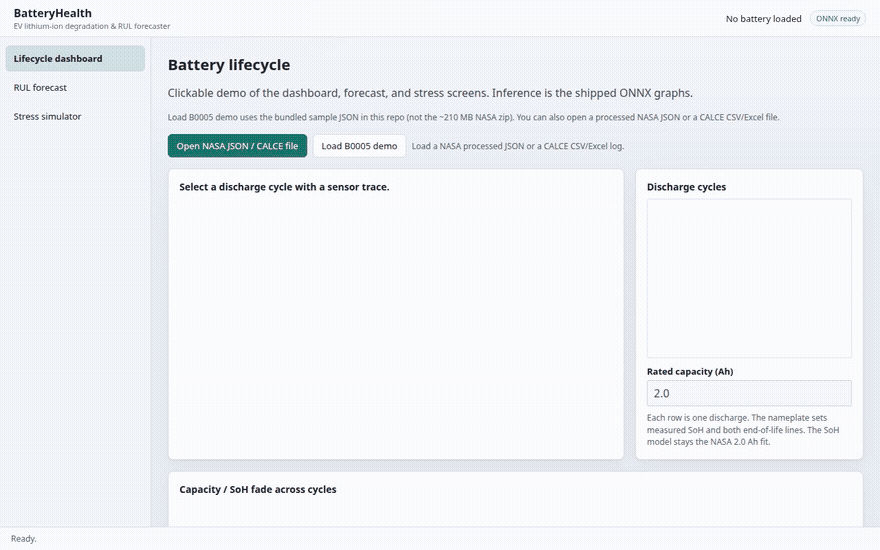
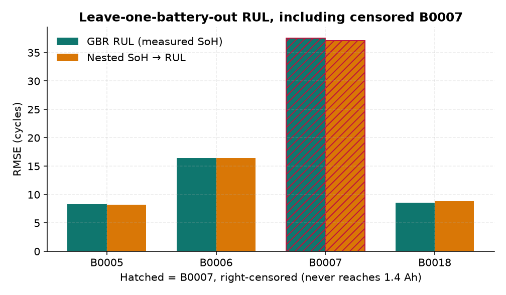
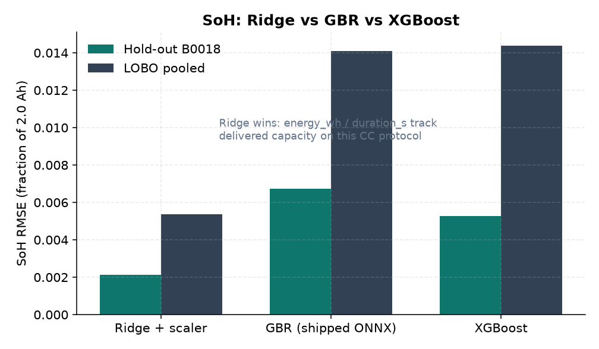
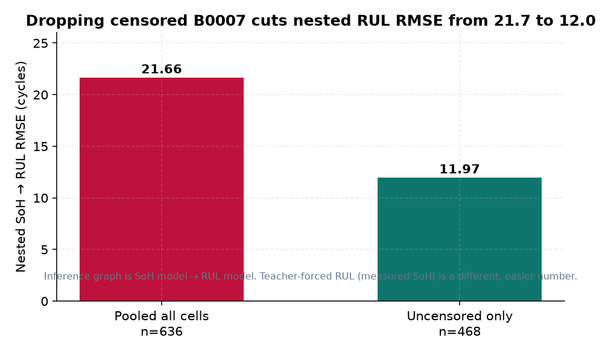
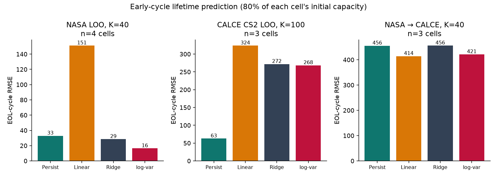
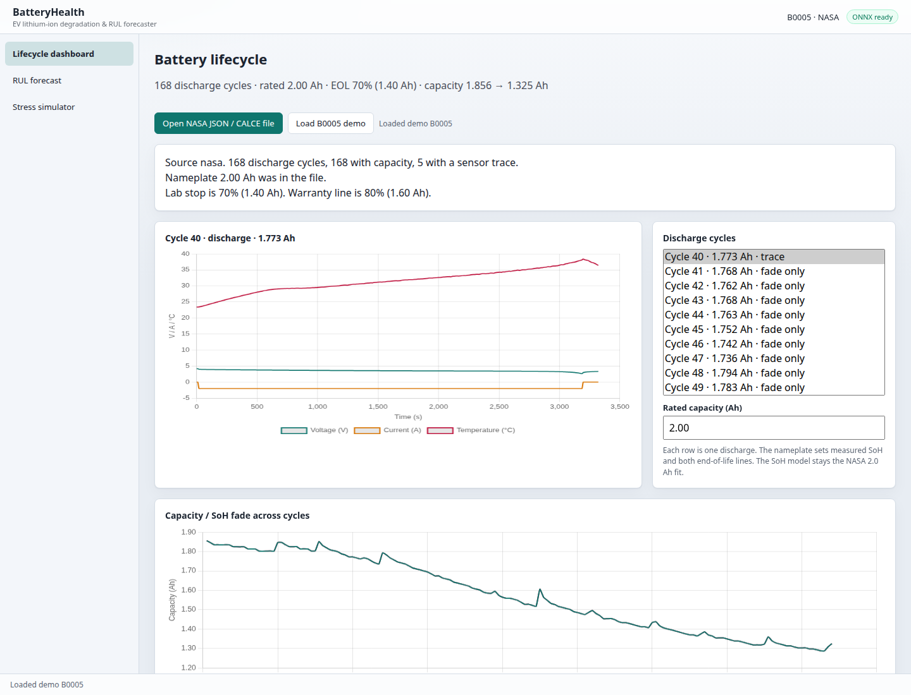
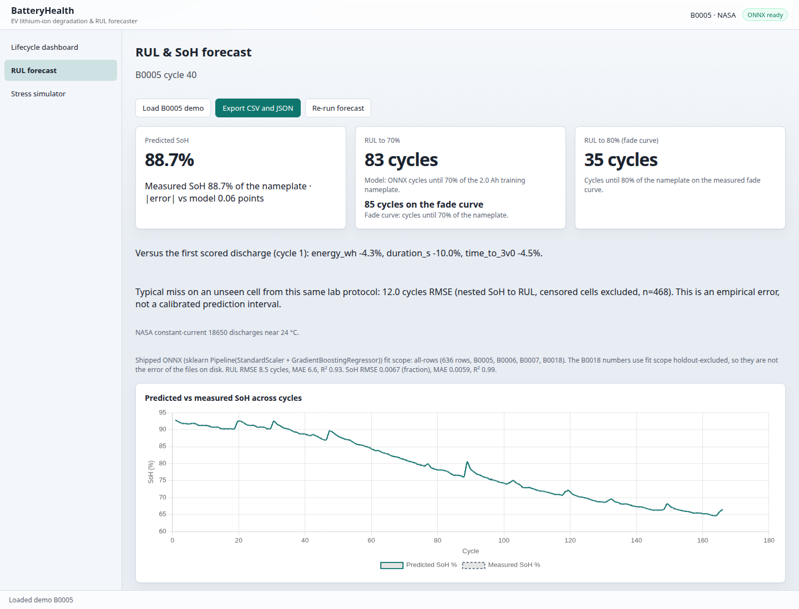
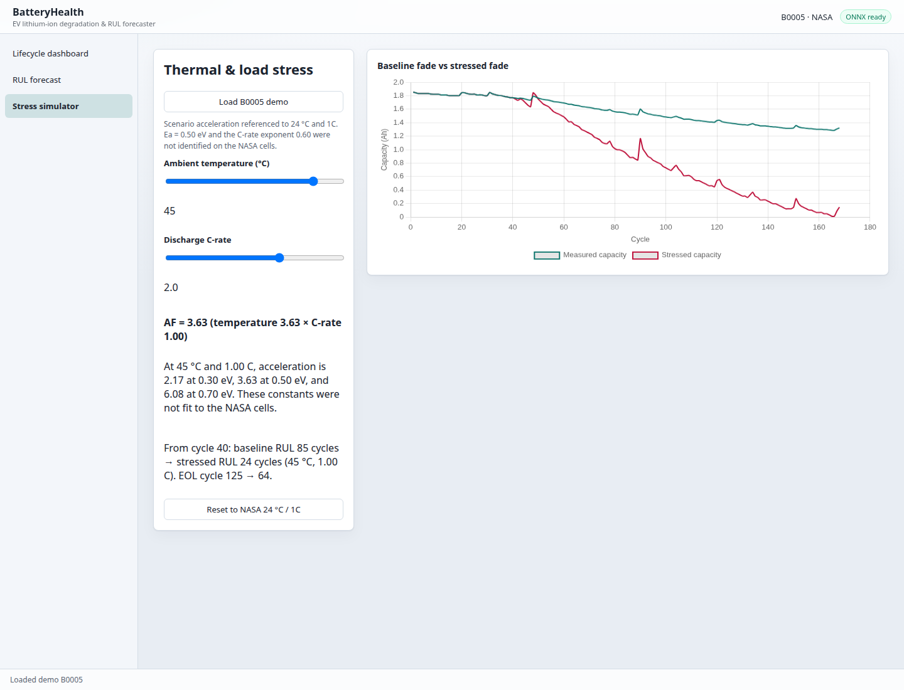

# BatteryHealth

Clickable **State of Health** and **Remaining Useful Life** demo for NASA PCoE 2.0 Ah 18650 cells. The primary UI is a FastAPI web app (dashboard, forecast with published error, stress simulator). A WinUI 3 desktop shell is an optional Windows-only wrapper around the same .NET Core library.

[](https://github.com/717Andy/battery-health/actions/workflows/ci.yml)
[](LICENSE)

**Hosted demo:** _not published — this environment has no `HF_TOKEN`._ After deploy, the Space URL is:

`https://huggingface.co/spaces/717Andy/battery-health`

Until then, run it locally (bundled fixtures + committed ONNX, **no 210 MB NASA zip**):

```bash
python -m pip install -r ml/requirements-space.txt
PYTHONPATH=ml python -m batteryhealth.service.app --host 127.0.0.1 --port 8765
# http://127.0.0.1:8765  →  Load B0005 demo
```



## Results (honest, not inflated)

Training set: NASA B0005 / B0006 / B0007 / B0018 — **636 discharge cycles**. Hold-out cell: **B0018** (132 cycles). Official EOL is **70% of 2.0 Ah (1.4 Ah)**.

The tables are **hold-out-excluded** fits (the scored cell was not in that fit). Files in `artifacts/models/` are a **separate all-rows** Gradient Boosting fit. Nested SoH→RUL on uncensored cells: **11.97 cycle RMSE, n=468**. B0007 never reaches 1.4 Ah (last 1.43 Ah), so its 70% RUL labels are right-censored.

| SoH (fraction of 2.0 Ah) | B0018 RMSE | B0018 MAE | B0018 R² | LOBO pooled RMSE |
| --- | ---: | ---: | ---: | ---: |
| Ridge + scaler | **0.0021** | 0.0018 | 0.999 | 0.0054 |
| Gradient boosting (shipped ONNX) | 0.0067 | 0.0059 | 0.992 | 0.0141 |
| XGBoost | 0.0053 | 0.0045 | 0.995 | 0.0144 |

Ridge wins SoH because `energy_wh` and `duration_s` are near-linear proxies for delivered capacity on this constant-current protocol. Capacity itself is not a model input. We still ship GBR so the ONNX graph is a tree model.

| RUL (cycles to 70% / 1.4 Ah) | B0018 RMSE | B0018 MAE | B0018 R² | LOBO pooled RMSE |
| --- | ---: | ---: | ---: | ---: |
| Ridge + scaler | 20.2 | 19.2 | 0.60 | 26.4 |
| **Gradient boosting (shipped ONNX)** | **8.54** | **6.64** | **0.93** | 21.8 |
| XGBoost | 8.59 | 6.39 | 0.93 | 22.1 |

LOBO RUL is dominated by censored B0007 (~38 cycle RMSE). B0005 / B0018 transfer at ~8 cycle RMSE. ONNX vs sklearn on 32 hold-out rows: SoH max \|Δ\| = 1.1×10⁻⁷, RUL max \|Δ\| = 1.2×10⁻⁵.

Stress overlay: Arrhenius \(E_a=0.50\,\mathrm{eV}\) × \((C/1\mathrm{C})^{0.60}\). Those constants were **not identified** on the NASA cells.

### Result figures

Regenerate from committed `artifacts/metrics.json` (no NASA download):

```bash
PYTHONPATH=ml python ml/scripts/plot_results.py
```

**Leave-one-battery-out RUL, including B0007.** Teacher-forced GBR (measured SoH) vs the inference graph (predicted SoH fed into RUL). B0007 is hatched: it never hits 1.4 Ah, so a last-cycle RUL of ~0 is not an observed failure. That cell is why pooled LOBO RUL looks like ~22 cycles.



**SoH: Ridge vs GBR vs XGBoost.** Ridge has the lowest error on this protocol. GBR is what we ship because it converts cleanly to ONNX, not because it wins SoH.



**Nested uncensored RUL.** Scoring the actual SoH→RUL pipeline and then dropping the censored cell gives **11.97 cycle RMSE (n=468)**. The 21.7 number includes B0007’s right-censored labels. The forecast UI quotes the uncensored figure and says it is empirical, not a prediction interval.



## Early-cycle lifetime (first K cycles → EOL)

Predict the cycle when capacity first falls to **80% of that cell's own initial capacity** (rolling-median crossing). This is a different job from the shipped per-cycle RUL ONNX head.

NASA 18650s hit that line around **61–125 cycles**, so K=100 would not be early. The NASA table uses **K=40**. CALCE CS2 pouch cells (1.1 Ah, 1C, official zips for CS2_35/36/38) last **~500–600 cycles**, so **K=100** is actually early there.

The “Severson-style” feature is **log variance of early capacity**, not the paper’s ΔQ(V) interpolant. We did not keep CALCE voltage-capacity curves in the compact fade extract.

| Setting | n | Persist RMSE | Linear RMSE | Ridge RMSE | log-var RMSE |
| --- | ---: | ---: | ---: | ---: | ---: |
| NASA leave-one-cell-out, K=40 | 4 | 32.9 | 151.2 | 28.5 | **16.4** |
| CALCE CS2 leave-one-cell-out, K=100 | 3 | **62.7** | 323.8 | 272.0 | 268.4 |
| NASA → CALCE domain shift, K=40 | 3 | 455.6 | 414.4 | 456.0 | 421.3 |

On four NASA cells, log-variance of the first 40 capacities beats a mean baseline. On three CALCE cells, **persist wins** — Ridge and log-var overfit with two training cells. Transferring the NASA fit to CALCE predicts ~90–160 cycle lives against 498–600 observed (**RMSE ~400 cycles**). That is a failed transfer, not a leaderboard number.



Regenerate:

```bash
# optional: rebuild CALCE fade from official zips (~35 MB each)
python ml/scripts/download_calce.py
PYTHONPATH=ml python -m batteryhealth.early_cycle
PYTHONPATH=ml python ml/scripts/plot_early_cycle.py
```

Compact fade tables (not the zips) live in `artifacts/early_cycle/`.

## Screenshots (Linux, bundled B0005 sample, cycle 40)

| Dashboard | Forecast | Stress @ 45 °C / 2C |
| --- | --- | --- |
|  |  |  |

Cycle 40 of the demo file: predicted SoH 88.7% vs measured 88.7%; ONNX RUL 83 cycles vs 85 on the fade curve to 1.4 Ah. Typical protocol miss shown on the forecast page: **12.0 cycles RMSE** (nested, uncensored, n=468) — empirical, not a calibrated interval. At 45 °C / 2C the overlay reports AF **5.50** and fade-based RUL 85 → 19 cycles.

## What is in this repo

| Path | Role |
| --- | --- |
| `ml/` | NASA/CALCE parse, features, train, evaluate, ONNX export, FastAPI demo |
| `ml/batteryhealth/service/static/` | Browser UI (dashboard / forecast / simulator) |
| `src/BatteryHealth.Core/` | .NET 8 library: parsers, features, ONNX, stress math |
| `src/BatteryHealth.Cli/` | Linux/Windows CLI |
| `src/BatteryHealth.App/` | Optional WinUI 3 shell (Windows only) |
| `tests/` | 28 xUnit tests for Core; compact NASA/CALCE fixtures |
| `artifacts/models/` | Shipped `soh.onnx`, `rul.onnx`, `feature_spec.json` |

Raw NASA `.mat` files are **not** committed. The official PCoE zip is about **210 MB**. The web demo does not fetch it. Retrain with `python -m batteryhealth.download` only if you want the full cells.

## Web demo

```bash
python -m pip install -r ml/requirements-space.txt
PYTHONPATH=ml python -m batteryhealth.service.app --host 127.0.0.1 --port 8765
```

Docker (same image Hugging Face Spaces builds):

```bash
docker build -t batteryhealth-demo .
docker run --rm -p 7860:7860 batteryhealth-demo
```

Publish a Space (needs a Hugging Face write token this environment does not have):

```bash
python -m pip install huggingface_hub
HF_TOKEN=hf_xxx python scripts/deploy_hf_space.py
```

See [docs/huggingface-space.md](docs/huggingface-space.md).

## CLI (any OS with .NET 8)

```bash
dotnet test BatteryHealth.Linux.slnf --configuration Release
dotnet run --project src/BatteryHealth.Cli --configuration Release -- forecast tests/fixtures/tiny_battery.json --cycle 1
dotnet run --project src/BatteryHealth.Cli --configuration Release -- simulate tests/fixtures/B0005.sample.json --temp 45 --crate 2 --cycle 40
```

On the 3-cycle B0005 fixture, cycle 1: predicted SoH **0.9276** vs measured **0.9282**; predicted RUL **120** cycles. Stress at 45 °C / 2C from cycle 40 on the demo fade curve: AF **5.50**, RUL **85 → 19** cycles.

## Optional WinUI 3 app (Windows)

The desktop project is a Fluent shell over `BatteryHealth.Core`. It is **not** the primary demo. Build it on Windows 10/11 with Visual Studio 2022 (Windows App SDK workload) or:

```powershell
dotnet build src\BatteryHealth.App\BatteryHealth.App.csproj -c Debug -p:Platform=x64
```

Restoring that `.csproj` on Linux fails with `NETSDK1100`. Use `BatteryHealth.Linux.slnf` here.

## Architecture

```
NASA .mat / CALCE CSV ──► parsers ──► features.csv
                                │
                   train.py ──► soh.onnx / rul.onnx
                                │
              BatteryHealth.Core (ONNX Runtime + stress math)
                                │
           ┌────────────────────┼────────────────────┐
           ▼                    ▼                    ▼
   FastAPI web demo      BatteryHealth.Cli    BatteryHealth.App
   (primary demo)                             (optional WinUI)
```

Production model: scikit-learn `Pipeline(StandardScaler + GradientBoostingRegressor)`, `n_estimators=180`, `max_depth=3`. XGBoost is trained for comparison. There is no shipped neural net.

## End-of-life definition

NASA Ames PCoE stopped these cells at **30% capacity fade** — **70% of rated capacity (1.4 Ah)**. That is the RUL training label. The UI also shows the common **80% OEM / warranty** line from the measured fade curve; the ONNX RUL head remains a 70%-EOL model.

Citation: B. Saha and K. Goebel (2007). “Battery Data Set”, NASA Prognostics Data Repository, NASA Ames Research Center, Moffett Field, CA.

## Robustness to added sensor noise

Features recomputed after i.i.d. Gaussian noise at *σ = f × channel std* on V/I/T (production GBR, all 636 cycles). The *f = 0* row is **in-sample**.

| Noise *f* | SoH RMSE | RUL RMSE |
| ---: | ---: | ---: |
| 0 | 0.0011 | 2.83 |
| 1% | 0.0013 | 3.79 |
| 2% | 0.0015 | 5.19 |
| 5% | 0.0021 | 10.3 |

## Stress simulator

Mirrored in Python (`ml/batteryhealth/simulate.py`) and C# (`DegradationSimulator`):

- Temperature: Arrhenius, \(A_T = \exp\left[\frac{E_a}{k}\left(\frac{1}{T_\mathrm{ref}}-\frac{1}{T}\right)\right]\), \(E_a = 0.50\,\mathrm{eV}\), \(T_\mathrm{ref} = 24\,^\circ\mathrm{C}\).
- C-rate: \((C / 1\mathrm{C})^{0.60}\).
- Remaining fade after the selected cycle is multiplied by \(A_T \cdot A_C\). This is a **scenario overlay**, not a fitted aging model.

## Feature vector

Same columns in Python and C# (`artifacts/models/feature_spec.json`):

`cycle_index`, voltage mean/std/min/max/start/end/slope, current mean/std, temperature mean/std/max/rise, `duration_s`, `energy_wh`, `time_to_3v5`, `time_to_3v0`, `ambient_temp_c`. RUL also receives `soh` (measured if the log has capacity, otherwise the SoH model’s output).

## Tests

```bash
PYTHONPATH=ml python -m pytest ml/tests -q          # 24 passed
dotnet test BatteryHealth.Linux.slnf                 # 28 passed
```

GitHub Actions (`.github/workflows/ci.yml`) runs those tests and a CLI `forecast` / `simulate` smoke on the fixtures. It does not retrain; the committed ONNX files are the artifact under test.

## Compared with industrial tools (scope only)

This is a laptop diagnostic on four NASA 18650s with published hold-out numbers. It is not a fleet data platform and not a physics pack model. Enterprise products in that space (for example Voltaiq or Ansys Twin Builder) solve different jobs — ingestion/compliance at OEM scale, or electrochemical/thermal FEM. No claim is made that BatteryHealth replaces them.

## Verified here vs not

**Verified on this Linux VM (Python 3.12, .NET 8):**

- NASA PCoE zip download and parse of B0005 / B0006 / B0007 / B0018 (zip ≈ 210 MB; not required for the demo)
- Feature tables, training, LOBO, noise study, ONNX export
- `pytest` — 24 passed
- `dotnet test` on `BatteryHealth.Linux.slnf` — 28 passed
- FastAPI demo: `/`, `/demo/B0005`, forecast, 45 °C / 2C stress
- CLI `forecast` / `simulate` / `export` on the fixtures

**Not compiled or clicked here:**

- `src/BatteryHealth.App` WinUI 3 (needs Windows)
- A live Hugging Face Space (no `HF_TOKEN` in this environment)
- Real CALCE `.xlsx` from calce.umd.edu (the CSV fixture **is** tested)

## Setup / retrain

```bash
python -m pip install -r ml/requirements.txt
export PYTHONPATH=ml
python -m batteryhealth.download    # ~210 MB zip; skip unless retraining
python -m batteryhealth.train
python -m pytest ml/tests -q
```

## License / data

[MIT](LICENSE) for the code. NASA PCoE battery files remain NASA’s. This repo ships code, fixtures, screenshots, and trained ONNX weights only.
